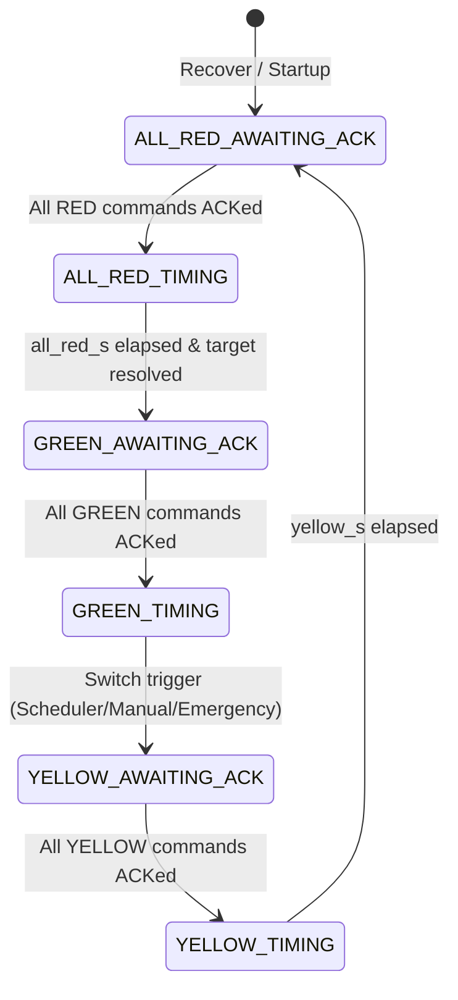

# Factory Traffic Management System

A safety-critical, real-time traffic management system for industrial intersections coordinating Trucks, Forklifts, Employee Vehicles, and Emergency Vehicles with deterministic state machines, ACK gating, and safety invariant validation.

---

## 1. Overview and Architecture

The application implements a **Functional Core / Imperative Shell** pattern with an **Actor-per-Junction** concurrency model:

```
  REST API (FastAPI) / SSE Live Stream
                   │
       Application Layer (JunctionRuntime Actor)
                   │
       Domain Engine (Pure Python Reducer)
                   │
  Ports (ControllerPort, Repositories, EventPublisher)
                   │
  Adapters (SQLite WAL, SimulatorController, SSEBroadcaster)
```

- **Functional Core**: `handle(state, config, input, now) -> Result(new_state, effects, outcome)`. Completely deterministic, free of external framework imports, verified by architectural AST tests.
- **Actor Model**: One bounded mailbox (`asyncio.Queue`) per junction serializes all events (sensor messages, ACKs, manual commands) without distributed locks.
- **Physical vs Desired State**: Physical lamp states are updated exclusively via controller ACKs. A GREEN signal is never issued unless all conflicting actual signals are physically confirmed RED.

---

## 2. Quick Start

### 2.1 Backend Setup & Run

```bash
cd Factory_Traffic_Management_System

# Create virtual environment & install dependencies
python -m venv .venv
source .venv/bin/activate  # Or on Windows: .\.venv\Scripts\activate
pip install -r backend/requirements.txt

# Run Backend (Default profile)
uvicorn app.main:app --app-dir backend --host 0.0.0.0 --port 8000

# Run Backend with Demo profile (Fast timings for evaluation)
TRAFFIC_PROFILE=demo uvicorn app.main:app --app-dir backend --host 0.0.0.0 --port 8000
```

### 2.2 Frontend Setup & Run

```bash
cd Factory_Traffic_Management_System/frontend
npm install
npm run dev      # Local Vite dev server on http://localhost:5173 (proxies /api to :8000)
npm run build    # Compiles production bundle to frontend/dist (auto-served by FastAPI)
```

The interactive dashboard is available at `http://localhost:8000` (production) or `http://localhost:5173` (dev).
Interactive API Swagger Docs: `http://localhost:8000/docs`.

### 2.3 Run All Automated Tests

```bash
cd Factory_Traffic_Management_System
.\.venv\Scripts\pytest -v backend/tests
```

### 2.4 Run Demo Driver (All 9 Scenarios)

```bash
cd Factory_Traffic_Management_System
python scripts/demo.py --all
```

---

## 3. Configuration & Profiles

Configured via environment variables or junction config JSON:

| Parameter | Default Profile | Demo Profile | Purpose |
|---|---|---|---|
| `green_max_s` | 30 s | 12 s | Maximum green duration when competing demand exists |
| `green_min_s` | 10 s | 4 s | Minimum green duration before automatic switch |
| `yellow_s` | 5 s | 3 s | Yellow clearance interval |
| `all_red_s` | 2 s | 1 s | Software all-red clearance interval |
| `ack_timeout_s` | 5 s | 3 s | Hardware ACK timeout before retry |
| `ack_max_retries` | 2 | 2 | Max command retries before entering DEGRADED |
| `manual_lease_s` | 300 s | 60 s | Operator manual override lease duration |
| `emergency_max_hold_s`| 60 s | 20 s | Maximum preemption hold for a single emergency |
| `emergency_stale_s` | 120 s | 30 s | Stale timeout for unrefreshed emergencies |
| `vehicle_ttl_s` | 900 s | 120 s | Ghost vehicle expiration timeout |
| `starvation_max_wait_s`| 90 s | 30 s | Starvation threshold triggering hard switch override |

Profile selection: `TRAFFIC_PROFILE=default|demo`.

---

## 4. API Documentation

Interactive Swagger UI: [http://localhost:8000/docs](http://localhost:8000/docs)
OpenAPI Specification: [`docs/openapi.json`](docs/openapi.json)
Complete API & Curl Reference: [`docs/api.md`](docs/api.md)

All API errors return consistent JSON:
```json
{
  "error": {
    "code": "MANUAL_LOCKED",
    "message": "Manual control is locked by another operator ('alice')",
    "details": {}
  }
}
```

---

## 5. Database Schema & Persistence

SQLite WAL mode (`traffic.db`) guarantees concurrent read performance and ACID atomicity. Full SQL schema exported to [`docs/schema.sql`](docs/schema.sql).

- `junctions`: Junction definitions and JSON configuration.
- `junction_state`: Full state snapshot with atomic `version` increment.
- `vehicles`: Granular tracking of waiting, cleared, and expired vehicles (derived queue source of truth).
- `processed_events`: Deduplication table preventing duplicate event processing.
- `pending_commands`: Commands sent to hardware awaiting ACK.
- `emergencies`: FIFO emergency queue.
- `audit_log`: Append-only structured event log with correlation IDs.

---

## 6. Traffic-Control Algorithm

In AUTOMATIC mode, priority scoring determines green allocation:

$$\text{Score}(\text{phase}) = \sum_{v \in \text{waiting}} \text{Weight}(v.\text{type}) \times \left(1 + \frac{\text{age\_s}}{60}\right)$$

- Weights: `EMERGENCY`: 50, `TRUCK`: 3, `FORKLIFT`: 2, `EMPLOYEE_VEHICLE`: 1.
- Offline sensor fallback: If a direction sensor is OFFLINE, it is assigned a constant phantom score of 3.0 so its phase continues to be served.
- Decision at `GREEN(p)` after `green_min_s`:
  1. No competing demand &rarr; Stay green (avoids flapping).
  2. Competing phase starved (`age >= starvation_max_wait_s`) &rarr; Hard switch override.
  3. `green_elapsed >= green_max_s` and demand exists &rarr; Switch.
  4. Current phase empty &rarr; Switch (Gap-out).
  5. $\text{Score}(\text{competing}) > 1.25 \times \text{Score}(\text{current})$ &rarr; Switch (1.25x hysteresis prevents oscillation).
  6. Otherwise &rarr; Stay.

---

## 7. Traffic-State Transitions

Deterministic sequence: `GREEN(p) -> YELLOW(p) -> ALL_RED -> GREEN(q)`



Detailed diagrams and tables: [`docs/state-machine.md`](docs/state-machine.md).

---

## 8. How to Demonstrate the Main Scenarios

Run the demo script:
```bash
python scripts/demo.py --scenario <1-9>
```

1. **Normal Traffic**: `python scripts/demo.py --scenario 1` (Queue-weighted phase switch).
2. **Priority Traffic**: `python scripts/demo.py --scenario 2` (Heavy truck priority vs aged employee cars).
3. **Emergency Preemption**: `python scripts/demo.py --scenario 3` (Immediate safe preemption sequence).
4. **Manual Override**: `python scripts/demo.py --scenario 4` (Lease timer + Bob 409 rejection).
5. **Duplicate Event**: `python scripts/demo.py --scenario 5` (Idempotent HTTP 200 `DUPLICATE`).
6. **Vehicle Clearance**: `python scripts/demo.py --scenario 6` (Tombstone handling & non-negative queue).
7. **Controller Failure**: `python scripts/demo.py --scenario 7` (ACK DROP &rarr; retry &rarr; DEGRADED fail-safe).
8. **Restart Recovery**: `python scripts/demo.py --scenario 8` (State durability & UNKNOWN actual re-sync).
9. **Concurrent Events**: `python scripts/demo.py --concurrent` (Asyncio simultaneous race-condition test).

---

## 9. Testing

The suite combines pure domain unit tests, integration tests with in-memory SQLite, and an architecture isolation scanner.

Run tests:
```bash
.\.venv\Scripts\pytest -v backend/tests
```

- `test_architecture.py`: Verifies pure domain isolation (AST scanning prohibits external framework imports).
- `test_safety.py`: Validates all 6 safety invariants.
- `test_stage_machine.py`: Tests ACK gating, timeout retries, fail-safe DEGRADED.
- `test_events_scheduler.py`: Tests deduplication, out-of-order clearance tombstones, ghost vehicle TTL, and scheduling weights.
- `test_policies_and_fuzz.py`: Tests emergency FIFO preemption, multi-admin locks, and a **2,000-step randomized invariant fuzz test**.
- `test_runtime_persistence.py`: Validates SQLite atomic commits, actor mailbox, and mid-transition restart recovery.
- `test_api_endpoints.py`: Tests FastAPI HTTP endpoints, error schemas, and simulator controls.

---

## 10. Assumptions / Questions / Requirement Issues

| Issue | Type | Decision Implemented |
|---|---|---|
| Faster clearance for high priority vs starvation prevention | Contradictory | Weighted aging score + hard starvation override (`starvation_max_wait_s`). |
| Emergency "immediately" vs "must not bypass safe transitions" | Contradictory | Sequence begins immediately (ignores `green_min_s`), but strictly executes YELLOW and ALL_RED. |
| `MANUAL_GREEN_REQUEST(direction)` implies single direction, but model has phases | Ambiguous | Grants the entire phase containing the requested direction. |
| Spec example ACK payload lacks direction | Missing | One command per direction; `command_id` identifies direction and stage. |
| `VEHICLE_CLEARED` example has no `vehicle_type` | Missing | Inherits vehicle type from prior arrival; tombstone type is null. |
| No rule for lost `VEHICLE_CLEARED` | Missing | `vehicle_ttl_s` automatically purges ghost vehicles to protect scoring. |
| Scope of `sequence_no` undefined | Ambiguous | Monotonic per direction sensor gateway; `event_id` used for exact deduplication. |
| Sensor vs server timestamp authority | Ambiguous | Server `received_at` is authoritative for scheduling; sensor timestamp used solely for sanity checks (>10m stale, >60s future skew). |
| Manual duration / disconnect / multi-admin undefined | Missing | Granted via lease (`manual_lease_s`), auto-expires on timeout; first operator locks out others with HTTP 409. |
| Emergency vs manual precedence | Missing | Emergency overrides manual; manual is suspended and resumes if lease remains valid. |
| Conflicting emergencies | Missing | FIFO queue ordered by detection; capped by `emergency_max_hold_s`. |
| ALL_RED duration undefined | Missing | Configurable software stage (`all_red_s`, default 2s). |
| Failure fail-safe state | Business Decision | All physical signals held RED (safer than flashing red in industrial settings). |
| Manual control has no authentication | Unsafe | Operator attribution (`requested_by`); API-key auth documented for production. |
| Single-process actor model scaling | Technical Limit | Optimistic concurrency version column (`version`) detects stale writes across processes. |
| Turning movements & pedestrians | Out of scope | Two-phase conflicting movements model. |
| Late ACK after retries exhausted | Ambiguous | Updates physical actual signal state and audits; never advances a stage. |
| Wall-clock jumps | Technical Limit | UTC timestamps utilized throughout. |

---

## 11. Major Architectural Decisions

1. **Python 3.11 + FastAPI + Pydantic v2**: Async-native architecture supporting actor mailboxes and strict validation.
2. **Pure Reducer Domain Engine**: Total determinism, clock injection, and zero framework coupling.
3. **Actor-per-Junction**: Removes locking deadlocks; serializes rapid concurrent inputs.
4. **SQLite WAL Mode**: Zero-setup deployment for evaluation with high-performance concurrent reads.
5. **Late-Bound Target Phase**: Target phase resolved upon ALL_RED completion, eliminating complex transition rollback logic.
6. **Server-Sent Events (SSE)**: Lightweight push updates with automatic browser reconnection.

---

## 12. AI / Tool Usage

Development was conducted with AI assistance (Claude / Gemini via Antigravity) for architectural drafting, boilerplate generation, and fuzz simulation authoring. All core domain logic, safety invariants, actor runtime, and test suites were verified and validated against the assessment requirements.

---

## 13. Known Limitations & Next Steps

1. **Authentication**: Manual commands currently use `requested_by` attribution without cryptographically signed tokens. Production deployments should enforce JWT/OAuth2 RBAC.
2. **Distributed Scaling**: The per-junction actor runs within a single process. Multi-node clusters should partition junctions using consistent hashing or distributed leasing.
3. **MQTT Adapter**: Controller communication currently runs via the REST simulator adapter; an `MqttController` implementing `ControllerPort` would be the immediate next integration.
4. **Sensor Diagnostics**: Add dead-letter logging for severely drifted or corrupted sensor packets.
