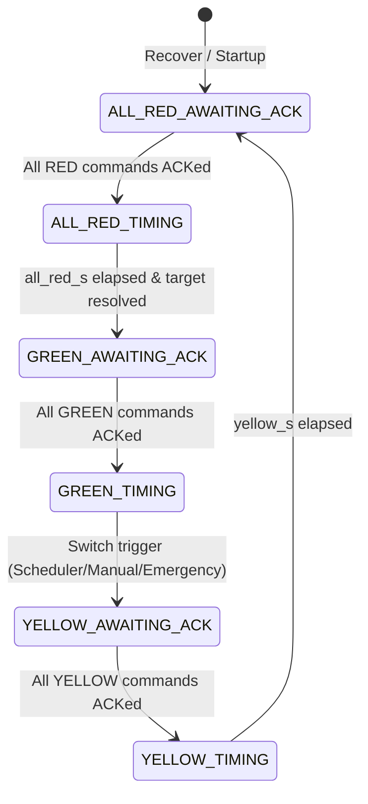
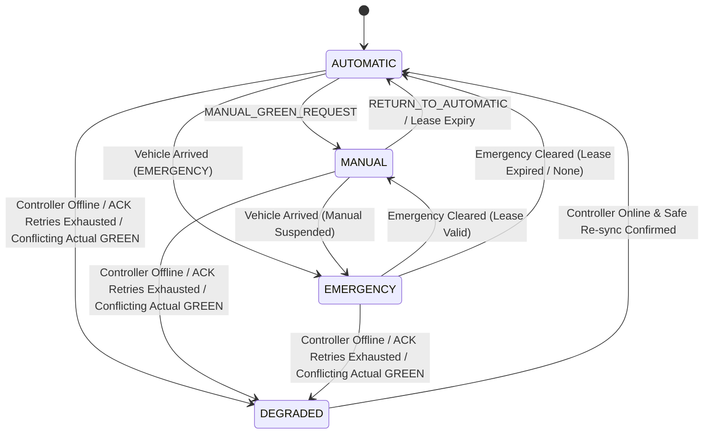

# Factory Traffic Management System - State Machine & Transitions

## 1. Safe Stage Transition Cycle

Every state transition in the system enforces the deterministic cycle. No cross-phase GREEN transitions are ever permitted without intermediate YELLOW and ALL_RED stages.

---

## 2. Operating Modes & Preemption Hierarchy

Preemption priority:
1. **DEGRADED**: Highest priority fail-safe. If controller fails, communication drops, or conflicting physical GREEN is observed, all signals are held physical RED.
2. **EMERGENCY**: Preempts MANUAL and AUTOMATIC. Ignores `green_min_s`. Suspends active manual lease.
3. **MANUAL**: Operator-controlled lease. Overrides AUTOMATIC.
4. **AUTOMATIC**: Demand-driven scheduling based on queue length, vehicle weight, and starvation aging.

---

## 3. Transition Table

| From Stage | Trigger | To Stage | Required Conditions | Notes |
|---|---|---|---|---|
| (Any) | `Recover` | `ALL_RED (AWAITING_ACK)` | System boot or reconnection | Actuals set to `UNKNOWN`; fresh command IDs |
| `ALL_RED (AWAITING_ACK)` | `ControllerAck` | `ALL_RED (TIMING)` | All pending commands ACKed | Starts `all_red_s` timer |
| `ALL_RED (TIMING)` | `Tick` | `GREEN(q) (AWAITING_ACK)` | `elapsed >= all_red_s` | Conflicting physical actuals confirmed RED |
| `GREEN(p) (AWAITING_ACK)` | `ControllerAck` | `GREEN(p) (TIMING)` | All pending commands ACKed | Starts green timer; records `phase_last_green` |
| `GREEN(p) (TIMING)` | `Tick` or `Event` | `YELLOW(p) (AWAITING_ACK)` | `should_leave(p)` is True | Scheduler, Emergency, or Manual switch |
| `YELLOW(p) (AWAITING_ACK)` | `ControllerAck` | `YELLOW(p) (TIMING)` | All pending commands ACKed | Starts `yellow_s` timer |
| `YELLOW(p) (TIMING)` | `Tick` | `ALL_RED (AWAITING_ACK)` | `elapsed >= yellow_s` | Emits commands for phase directions to RED |
| `AWAITING_ACK` | `NACK / Mismatch` | `AWAITING_ACK (Retry)` | `attempts < ack_max_retries` | Resends same `command_id`; increments attempt |
| (Any) | Retries Exhausted | `DEGRADED (ALL_RED)` | `attempts >= ack_max_retries` | All desired set to RED; actuals marked UNKNOWN |
| (Any) | Conflicting Actual GREEN | `DEGRADED (ALL_RED)` | Conflicting directions report GREEN | Safety fail-safe; audit `SAFETY_VIOLATION_OBSERVED` |
